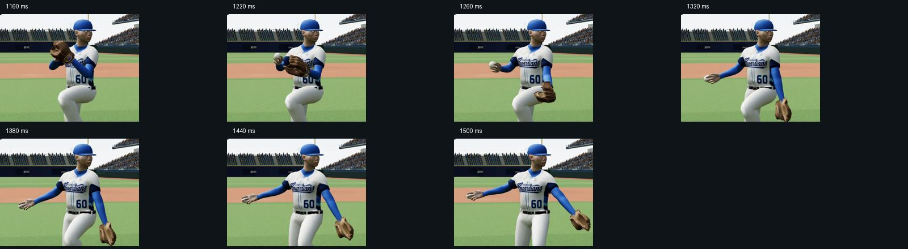

# 曾峻岳分手與手套側伸臂 — preview20

## 實際查看的參考

- [曾峻岳154kph96mph投球慢動作2024/05/12](https://www.youtube.com/watch?v=XNdHZq_PQAw)，攝影者詹家欣。本次重新播放、暫停查看 1/4 速片段約 21.787 秒，另比對先前保存的 21.617 秒畫面。
- 可見手套側由肩膀帶動長臂下降，肘部接近伸直，再向本壘方向帶出。拿球手由合手位置連續分開。不能把手套拉在肩膀附近，再用彎肘補足位置。
- 這是 2024/05/12 此次投球的影像；不宣稱代表所有球種或 2026 年每次投球。

## 修正與推估

- 曾峻岳手套側分手至前伸改為肩、肘 FK 路徑，該段肘部約 8 度微彎。方向、角度及前後銜接為對照畫面的手工推估，並非動態捕捉或實測解剖數據。
- 拿球手原本混合持續變動的舊 IK 目標和新 FK；舊 IK 的控制階段切換時，混合基準也跟著改變，造成瞬間移位。改為固定合手姿勢作為混合起點，再連續進入 FK。
- 手套手的混合起點同樣固定，避免在進入伸臂前產生新的跳動。左右投共用相應側的骨架；左投僅鏡像示意。

## 檢查紀錄

- 透過預覽時間滑桿以 20 ms 間隔檢查 1120–1580 ms，保存肩、肘、腕世界座標於 after.json；before.json 為原版本 1160–1560 ms。
- 1380–1500 ms，原手套側三點測得彎曲約 118–80 度，修正後約 8 度。這些是模型幾何診斷，不是影片中球員的量測角度。
- 原拿球手在 1380 ms 前後單一 20 ms 取樣位移約 0.086 m；修正後同一區間約 0.023 m，前後樣本呈連續變化。
- 查看雙臂近景、投球側面、左投鏡像；另在 1440 ms 切換四縫線、伸卡球、曲球、變速球，手套側彎曲皆約 8 度。1900 ms 出手點與掌中球接點誤差顯示 0.000000。
- JavaScript 語法檢查通過。仍為人工關鍵姿勢重建，不能僅因肘軸診斷或接球點誤差正常，就聲稱全部動作已完全符合人體力學。

