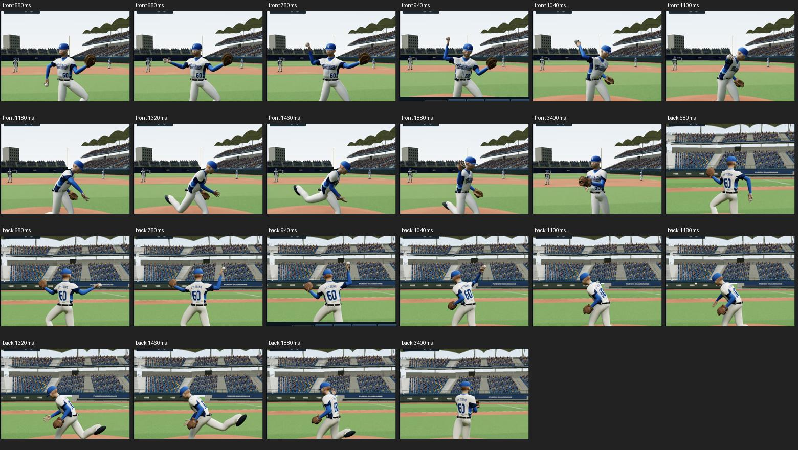
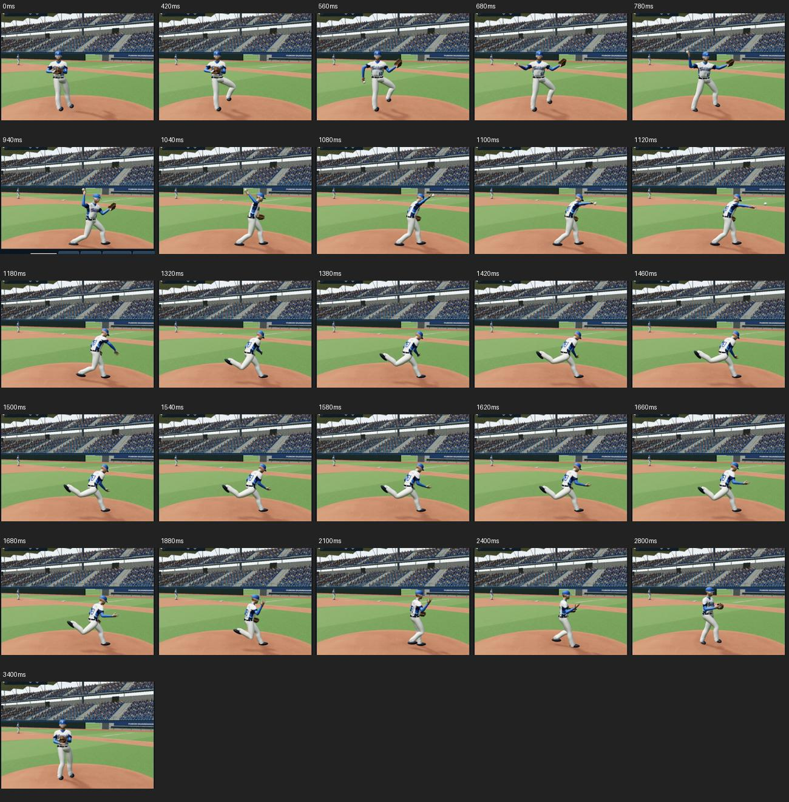
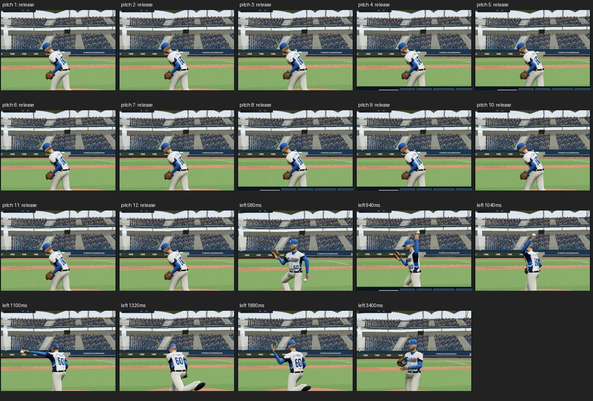
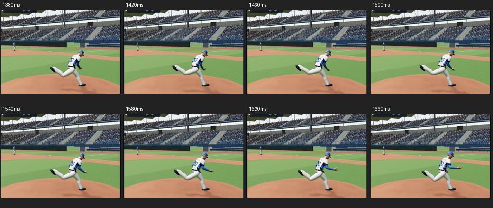

# 投球協調重建 · 32.0-preview17

## 實際參考與觀察

研究來源與可播放範圍見 [投球慢動作研究](../pitching-study-20261015/README.md)。實際查看 MLB Skenes 慢動作 16.5–20 秒，以及既存曾峻岳 17.0–18.2 秒連續截圖；前者用於機制觀察，不能冒充曾峻岳個人動作。

觀察：分手、跨步、抬前臂與軀幹旋轉重疊；肩外旋與手肘彎伸分屬不同運動；出手後手臂減速、後腳上擺，手臂再回彈。數值曲線與時間均為作者重建推估，沒有匯入動捕資料。

## 本版實作

- 560–680 ms 從合手接觸 IK 平順交接；之後投球臂由獨立肩外展、水平角、外旋、肘屈曲及前臂旋轉控制。
- 前臂從胸前抬起；手肘採單軸彎伸，旋轉分配到前臂骨與手腕，旋轉角繞固定中立框架連續化。
- 940 ms 前腳落地、1040 ms 肩最大後仰、1100 ms 出手，接續減速、收尾回彈、回到合手。這些是預覽時間，非影片量測值。
- 出手肘屈曲控制值 25 度；這是控制骨角度，不等同於獨立生物力學量測。
- 重心隨跨步前移，骨盆高度依腳踝可達距離調整；後腳推進拖移後上擺，前腳維持支撐。
- 手套手配合軀幹收回；回到準備時投球手依實際手套開口接近。保留球種握法、縫線與旋轉差異。
- 新增投球側面按鈕與階段名稱，雙臂近景跟隨人物重心，避免出手臂移出畫面。

## 手動檢查

正、背面查看 580、680、780、940、1040、1100、1180、1320、1460、1880、3400 ms；側面另查看 0–3400 ms 的 19 個時點。另檢查 12 個球種選項在 940/1100 ms，以及左投鏡像 580–3400 ms 的 7 個時點。

出手瞬間完成接地修正後，球與手掌接點差為 0.000000 m；兩側肘控制骨離軸讀值為零，渲染錯誤計數為零。這些是程式內診斷，不能單獨證明蒙皮、穿模或整段人體力學完全正確。腳踝目標與接地後位置有約 0.0178 m 垂直差，來自腳踝目標與鞋底偏移定義，水平目標保持對齊。

球種圖序：四縫線、二縫線、伸卡、卡特、滑球、橫掃、曲球、變速、指叉、掌心、蝴蝶、快速球。左投為鏡像示意，不宣稱是曾峻岳左投。

## 同次後續：前導手與 1380–1660 ms 腳部

重新查看曾峻岳 17.4、17.6 秒原始截圖，前導手先朝本壘延伸，隨胸腔轉向再收回。改用前導手世界延伸與胸腔局部收回的連續目標；骨盆、胸腔在落地前保留較多閉合角度。

1380–1660 ms 發現騰空後腿沿用站立膝方向與水平腳掌。改以向下的後膝控制平面連續交接，鞋掌取消強制水平並配合上擺轉動；前腳踩定後維持方向，膝蓋與腳尖同向。新增每 40 ms 的側面檢查（1380、1420、1460、1500、1540、1580、1620、1660）。

