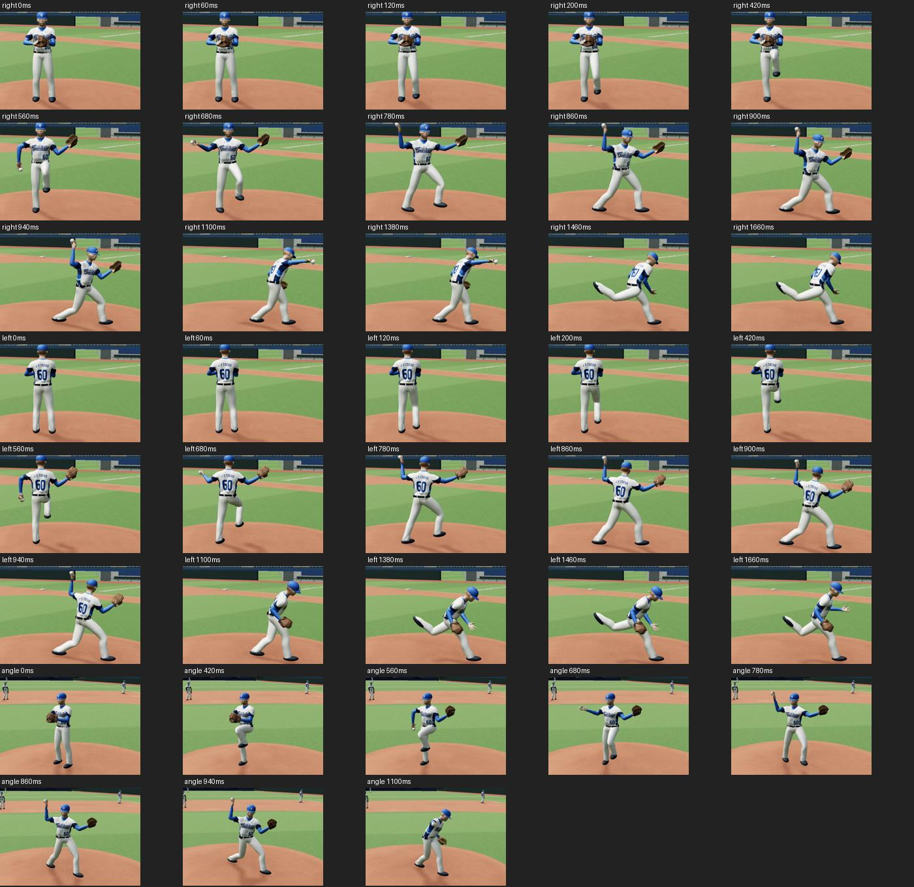

# 前跨腳與腳踝銜接 · 32.0-preview18

## 實際查看

重新查看 [CPBL 曾峻岳影片](https://www.youtube.com/watch?v=6S478_i36Lc) 既存的 17.2、17.4 秒原始截圖，以及前次 [投球研究](../pitching-study-20261015/README.md)。照片顯示前腿伸展、骨盆前移和軀幹轉向有重疊；不能把腳掌獨立直接拉向落點。單視角看不清楚的髖膝與腳踝位置屬重建推估，沒有新增動捕。

## 確認的程式問題與修正

1. 鞋子轉向已獨立，但鞋子中心仍保留小腿座標的固定前偏移，造成鞋與腳踝錯位。現在以前踝為中心，使用鞋子自身朝向計算鞋面偏移；腳掌與踝骨共用朝向。
2. 前跨腳過去只以簡單縱向位置與抬高量驅動。現在抬膝階段先收腳，再向前展開小腿，經 560、680、780、860、940 ms 連續軌跡落地。這些時間與位置是作者設定，非實測。
3. 前膝方向由閉合站姿的軀幹前方平順轉向本壘，腳掌朝向同步轉動；左右投鏡像方向一併修正。
4. 940 ms 後前腳位置維持踩定，保留前版 1380–1660 ms 後腿彎膝修正。

## 手動查看範圍

左右投各查看 0、200、420、560、680、780、860、900、940、1100、1380、1460、1660 ms；另以斜前方角度查看 0–1100 ms 的 8 個時點。渲染錯誤計數為零，出手球與手掌接點距離讀值 0.000000 m。內部讀值無法取代人體動作與蒙皮的視覺校正。

## 起始前腿站位再校正

使用者指出抬腿前就錯位，繼續檢查 0 ms。原程式側身骨盆搭配正面站姿的世界左右腳偏移，造成髖、膝、踝不在同一站姿平面；且骨盆可達高度到 700 ms 才修正。現在起始兩腳改用側身髖部下方附近的落點，身體中心對齊兩腳之間，骨盆可達高度從 0 ms 開始計算，前膝與腳尖維持閉合站姿方向後才轉向跨步。增加 0、60、120 ms 起始檢查。參考畫面能看見 17.0 秒已在抬膝，16.0 秒則為切鏡，無法據此精確量測曾峻岳抬腿前的腳距；本次起始腳距是依骨架與支撐關係校正的推估，非聲稱影片直接量得。
