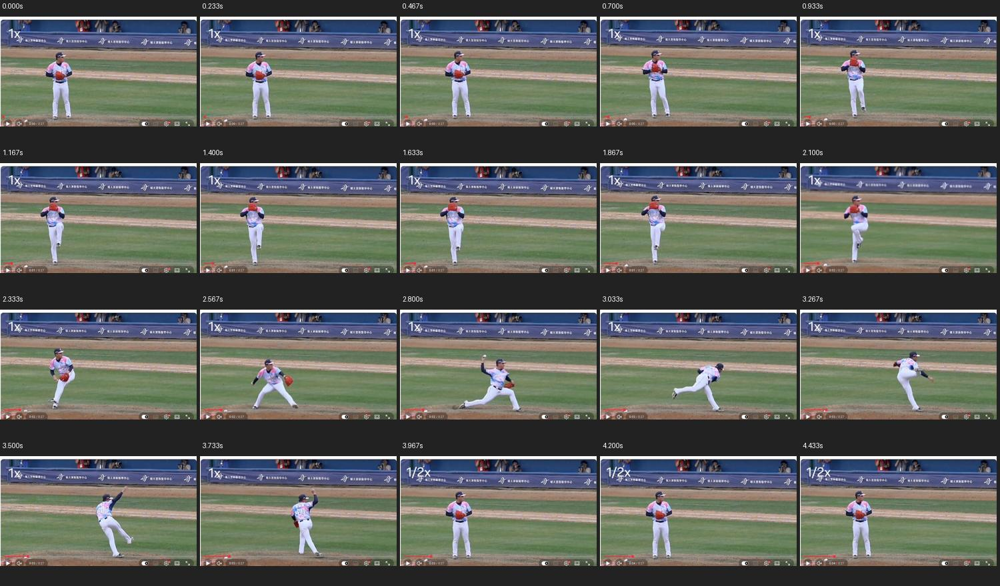
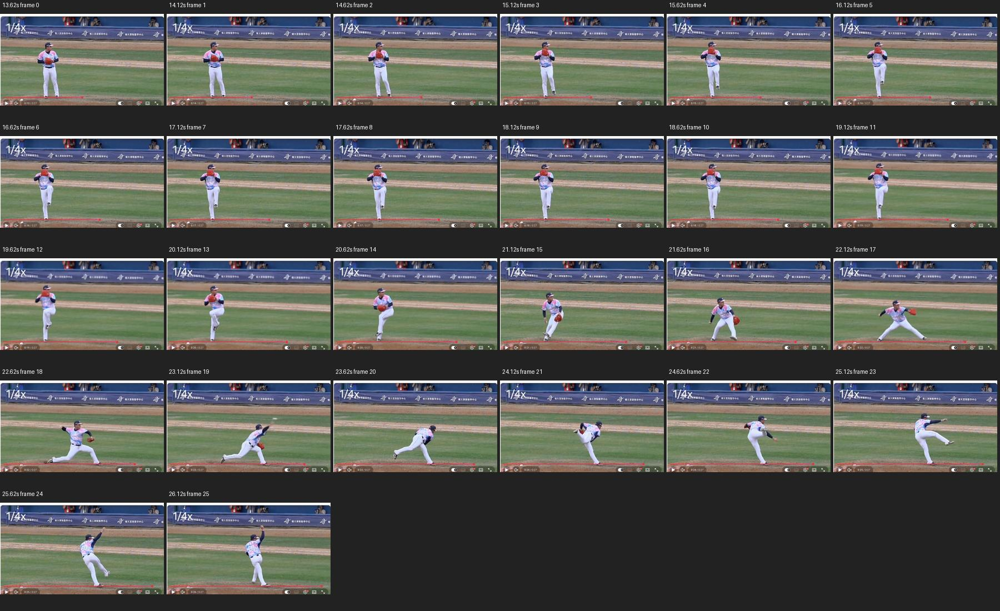
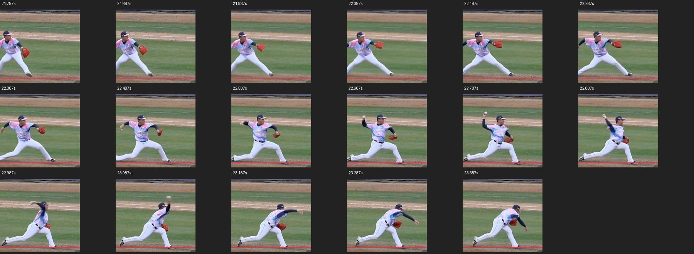
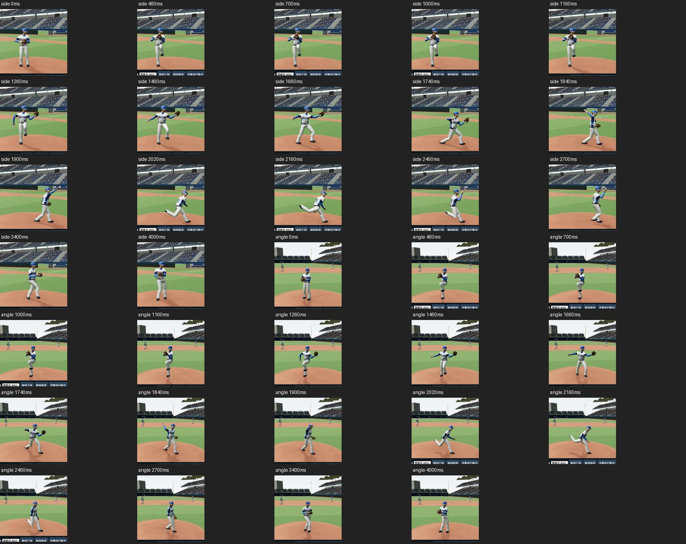
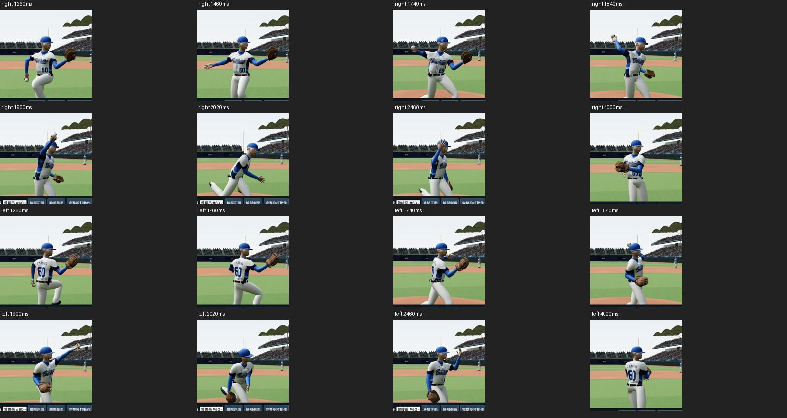
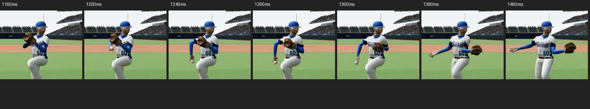

# 曾峻岳個人投球事件校正 · 32.0-preview19.1

## 實際查看的影像

- [曾峻岳 154kph 96mph 投球慢動作 2024/05/12](https://www.youtube.com/watch?v=XNdHZq_PQAw)，詹家欣拍攝，片內標示 1x、1/2x、1/4x。實際在瀏覽器播放、暫停與逐格前進；查看原速 0–4.43 秒、1/4 段落 13.62–26.12 秒，以及出手附近 21.79–23.39 秒。沒有下載或匯入遠端影片檔。
- [CPBL 官方曾峻岳比賽片段](https://www.youtube.com/watch?v=6S478_i36Lc)，前次實際播放後保存的 17.0–18.2 秒原始畫面，用於收尾交叉比對。
- 原速與慢放顯示的是這次投球，不能據此宣稱還原 2026 全季、所有球種或每次有無跑者時的姿勢。

## 可直接觀察到的個人特徵

|階段|原速影片大約位置|畫面觀察|
|---|---|---|
|準備|0–0.70 s|側身合手，眼睛朝本壘|
|抬膝|0.93–1.40 s|合手提高至上胸口／臉下，左膝升到髖部附近，小腿收起|
|蓄勢|1.40–2.10 s|原速畫面也可見高抬膝姿勢的停留，手仍合在一起|
|分手跨步|2.10–2.57 s|手下降分開，前腿展開；手套重新前伸與身體前移重疊|
|落地舉臂|約 2.70–2.85 s|前腳先踩下，投球前臂才快速抬起；手套開始收回|
|出手|約 2.88–2.97 s|投球手在頭上方附近通過，胸腔旋轉後向前跟隨|
|收尾|3.03–3.27 s|投球手向下跟隨，後腿抬起，手套靠近髖側|
|回彈|3.50–3.73 s|投球手再次上帶到頭上方，後腳回到前方|

影片時間是從瀏覽器播放器讀取的時間，事件判讀受畫質、角度、剪輯及取樣間隔影響。肩肘三維角、腳距、精確重心與旋轉軸仍是作者推估；没有動捕或多機位三維解算。

## 本版實作

1. 在 `player-characters.js` 建立曾峻岳專用事件時鐘，對齊高抬膝、蓄勢、分手、落地與回彈。動作從 0–4000 ms，出手設定 1900 ms，是對照這顆參考球的重建估值。
2. 主比賽轉播與人物預覽共用出手時間；曾峻岳不再以通用 1100 ms 提早離手。其他投手仍使用原來的通用時間。
3. 抬膝時合手位置提高，蓄勢期間維持接觸，分手後才接到抬臂曲線。
4. 調整曾峻岳的舉前臂時序、出手臂角與軀幹傾斜，保留手肘單軸彎伸；出手後手套降至髖側，投球手回彈提高。
5. 頭部朝本壘，轉角分散到三個頸頭控制骨，避免頭整段隨胸腔轉走。
6. 預覽按鈕、滑桿範圍、階段文字和握球／收尾入口同步使用個人事件時鐘。1900 ms 已取代前版出手時刻。

## 手動檢查與限制

側面、斜前方查看 0、460、700、1000、1160、1260、1460、1660、1740、1840、1900、2020、2160、2460、2700、3400、4000 ms；另查看左右投鏡像的雙臂近景。12 個球種選項與左右手的 1900 ms 球掌接點誤差讀值 0.000000 m，肘離軸讀值零，渲染錯誤零。這只證明程式接點與控制骨診斷，不是蒙皮和人體動作全部通過的保證。

只有參考球的投球節奏與個人特徵進一步校正；不同球種仍使用既有握法／旋轉示意，沒有宣稱曾峻岳會投清單中的全部球種。左投是鏡像示意，不是他的真實左投。

### 分手交接補正

500–680 的內部動作時間以同一個連續權重銜接合手與手套前伸，包含先下降分手再前伸，避免 560 邊界瞬間換位置。

